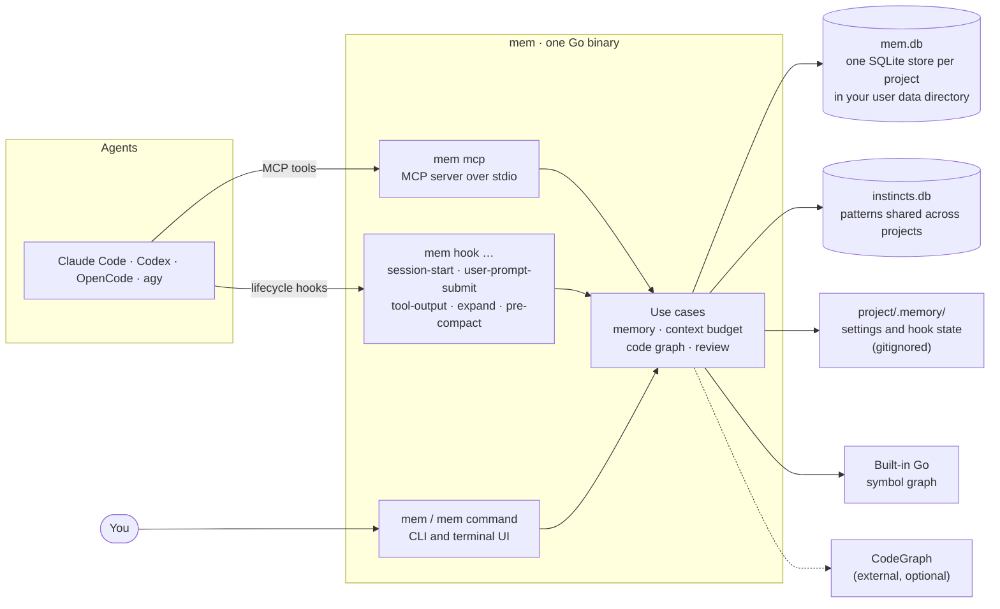

<p align="center">
  <picture>
    <source media="(prefers-color-scheme: dark)" srcset="assets/gomemory-readme-dark.png">
    
  </picture>
</p>

<h3 align="center">Persistent, local memory for AI coding agents</h3>

<p align="center">
  <a href="https://github.com/Sayoner-000/gomemory/releases/latest"></a>
  <a href="https://github.com/Sayoner-000/gomemory/actions/workflows/test.yml"></a>
  <a href="https://go.dev/"></a>
  <a href="LICENSE"></a>
  <a href="https://modelcontextprotocol.io/"></a>
</p>

<p align="center">
  <a href="#quick-start">Quick start</a> ·
  <a href="#how-it-works">How it works</a> ·
  <a href="docs/MANUAL.md">Manual</a> ·
  <a href="INSTALLATION.md">Installation</a> ·
  <a href="CHANGELOG.md">Changelog</a>
</p>

---

Coding agents forget everything between sessions: why you chose an
architecture, or how a flaky test finally got fixed. gomemory keeps that
knowledge in a local SQLite database per project and hands it back to the
agent through the [Model Context Protocol](https://modelcontextprotocol.io/)
(MCP).

It is one Go binary. It needs no cloud service or database server, and there is
no API key to manage. The memory store lives in your user data directory, not in
the repository. `mem install` writes the agent configuration (MCP entries, hooks
and skills) into the project and your home directory, and adds `.memory/` and
`mem` to `.gitignore`. If `mem` is not on your PATH, it can copy the binary into
the project. [`INSTALLATION.md`](INSTALLATION.md) describes where each agent's
configuration goes.

The manual, the installation guide and most CLI messages are in Spanish.

## Quick start

Install the binary on Linux or macOS:

```bash
curl -fsSL https://raw.githubusercontent.com/Sayoner-000/gomemory/main/scripts/install.sh | bash
```

On Windows, download `mem_windows_amd64.zip` from
[Releases](https://github.com/Sayoner-000/gomemory/releases/latest), check it
against `checksums.txt` and put `mem.exe` on your PATH.
[`INSTALLATION.md`](INSTALLATION.md) (Spanish) has the PowerShell commands.

Connect your agents from the project root:

```bash
cd /path/to/your/project
mem install .
```

The setup detects installed agents, asks which ones to connect and a few
settings such as language (`es` or `en`), and confirms before writing. For
scripts and CI, use `mem install . --yes` or pass `--agents`, `--scope` and
`--lang` explicitly. To register Claude Code, Codex and OpenCode once for every
project instead, run `mem setup-mcp --scope global`.

Then try it:

```bash
mem save -t "API routing" -y decision "Use Fiber for HTTP routing"   # -y is the type
mem search "API routing"
mem context        # the memory context agents receive at session start
mem doctor         # check every agent integration
mem                # terminal UI
```

## How it works



Agents reach gomemory in two ways. They launch `mem mcp` and call its tools to
save and retrieve memory. They also run `mem hook` at lifecycle events, which
lets gomemory inject context when a session starts, record checkpoints without
spending agent tokens, compress large tool output and restore memory after a
context compaction. The MCP server, the hooks and the CLI share the same use
cases, so the CLI shows the same memory the agent works with.

| Agent | MCP | Lifecycle hooks |
| :--- | :---: | :---: |
| Claude Code | ✅ | ✅ |
| Codex | ✅ | ✅ |
| OpenCode | ✅ | ✅ |
| Antigravity CLI (`agy`) | ✅ | ✅ (no tool output compression or post-compaction restore) |
| Cursor | ✅ | ❌ |

Antigravity CLI is enabled with `mem install --agents agy`. Its hooks do not
receive tool output and it has no compaction event, so gomemory
does not compress its tool output automatically and does not restore context
after compaction.

Each agent working in the same project gets its own session. For agents not
listed here, see [`docs/AGENT-INTEGRATION.md`](docs/AGENT-INTEGRATION.md).

## Features

- Typed memory entries (`decision`, `bugfix`, `architecture`, `learning` and
  others) with full-text search ranked by BM25.
- Context under a token budget. The agent receives summaries and asks
  `get_memory` for the full entry when it needs it. `mem usage` reports the
  tokens saved.
- Linked memories ranked by centrality (`mem mass`). Duplicates and memories
  that cite missing files are flagged for review; nothing is deleted silently.
- `mem plan-context` gives the agent the project history and a task
  decomposition method before it plans.
- `mem review` runs an adversarial review with two independent reviewers. A
  severe defect that both confirm blocks approval, and a severe finding where
  they contradict each other escalates the review.
- A built-in Go symbol graph, plus [CodeGraph](https://github.com/colbymchenry/codegraph)
  as the external multi-language graph.
- `expand` rules that keep agents on their native read, search and edit tools
  instead of `cat`, `grep -r` or `sed -i` in the shell.
- `mem doctor --fix` repairs the integrations gomemory manages and runs the
  diagnosis again. It asks once for the project changes and once for each
  change that affects the whole machine; `--yes` skips the questions.
- Optional Octopus AAR routing, which recommends whether to run a task inline
  or in a subagent.

`mem export` and `mem import` move memory between machines as JSON. The
[manual](docs/MANUAL.md) covers every feature.

## HCD

HCD (Harness Continual Development) takes a unit of work from intent to a
verified delivery that you approve. Each unit is one Markdown document in
`hcd/` that travels with your pull request. The `mem hcd` engine derives the
current step, accepts a task only after its check passed, requires a failing
run before a fix and binds approvals to the exact revision you saw.

There is a fast track for ordinary work and a full ceremony for changes with
open, interdependent decisions or high risk. Start with `/hcd` in Claude Code
or OpenCode, or `$hcd` in Codex. The
[SDD_HCD guide](docs/Guia-SDD_HCD_GOMEMORY-v2.56.html) (Spanish) walks through
it, and [`docs/HCD-VERIFICATION.md`](docs/HCD-VERIFICATION.md) explains how
evidence is recorded.

## Reference

<details>
<summary><b>CLI</b></summary>

| Command | Purpose |
| :--- | :--- |
| `mem install .` | Guided setup for a project |
| `mem lang [es\|en]` | Switch the project language |
| `mem save` / `mem search` / `mem list` | Write and query memory |
| `mem context` / `mem plan-context` | Show what the agent receives |
| `mem settings` | View or change project settings |
| `mem doctor [--fix]` | Check agent integrations and repair what gomemory manages |
| `mem update` | Update the binary (SHA-256 verified) |
| `mem optimize` | Clean graph relations and optimize SQLite indexes |
| `mem hcd` | HCD engine |
| `mem export` / `mem import` | Back up or move memory |
| `mem uninstall` | Remove gomemory from a project, or everywhere with `--all`. In a terminal it asks what to do with the memory; with `--yes` or without a terminal it deletes it unless you pass `--keep-memory` or `--export <dir>` |

Run `mem help` for the full list. Settings are documented in
[`docs/CONFIGURATION.md`](docs/CONFIGURATION.md).

</details>

<details>
<summary><b>MCP tools</b> (33, plus 4 with Octopus AAR)</summary>

The source of truth is [`domain/mcp_tools.go`](domain/mcp_tools.go).

| Group | Tools |
| :--- | :--- |
| Memory | `save_memory` `search_memories` `list_memories` `get_memory` `get_context` `get_plan_context` `start_session` `end_session` `save_session_summary` `forget_memory` `judge_memories` `hcd_history` `hcd_rename` |
| Code graph | `index_project` `graph_status` `search_code` `get_symbol` `list_dependencies` |
| Context packs | `pack_build` `pack_show` `pack_stats` `pack_compress` `pack_retrieve` `pack_savings` |
| Consensus review | `review_start` `review_submit` `review_consensus` `review_status` `review_fix_record` `review_rejudge` `review_finalize` `review_promote_memory` |
| Socratica (prompt refinement) | `socratica_flow` |
| Octopus AAR (optional) | `octopus_route_task` `octopus_route_plan` `octopus_report` `octopus_status` |

Resources: `mem://context` · `mem://memory/{id}`

</details>

## Security and privacy

Data stays on your machine. The memory store sits outside the repository, and
on Linux and macOS its files are readable only by your user. Per-project
settings and hook state live in the gitignored `.memory/` folder. gomemory
opens no network port. It goes online only to check for a
new release (you can turn this off) and to download one when you run
`mem update`.

Common credential patterns are redacted before storage, and anything wrapped in
`<private>…</private>` is never saved. Don't sync `mem.db` directly: it runs in
SQLite WAL mode, and a copy taken while it is open can be inconsistent. Use
`mem export` instead.

## Documentation

| Document | Contents |
| :--- | :--- |
| [`docs/README.md`](docs/README.md) | Documentation index |
| [`INSTALLATION.md`](INSTALLATION.md) | Installation, updates and troubleshooting (Spanish) |
| [`docs/MANUAL.md`](docs/MANUAL.md) | User guide and CLI reference (Spanish) |
| [`docs/ARQUITECTURA.md`](docs/ARQUITECTURA.md) | Architecture and SQLite design (Spanish) |
| [`docs/CONFIGURATION.md`](docs/CONFIGURATION.md) | Settings reference |
| [`docs/MEMORY-PROTOCOL.md`](docs/MEMORY-PROTOCOL.md) | Memory protocol |
| [`docs/AGENT-INTEGRATION.md`](docs/AGENT-INTEGRATION.md) | Connecting an unsupported agent |
| [`docs/PERFORMANCE.md`](docs/PERFORMANCE.md) | Benchmarks and how to reproduce them |
| [`CHANGELOG.md`](CHANGELOG.md) | Changes by release |

## Contributing

Report bugs and ideas in [issues](https://github.com/Sayoner-000/gomemory/issues).
Read [`CONTRIBUTING.md`](CONTRIBUTING.md) and the
[`CODE_OF_CONDUCT.md`](CODE_OF_CONDUCT.md) before sending a change.

Building from source requires Go 1.27+:

```bash
git clone https://github.com/Sayoner-000/gomemory.git
cd gomemory
go build -o mem ./infrastructure/
./mem install .
```

## License

MIT, see [`LICENSE`](LICENSE). Created by Sayoner ([@Sayoner-000](https://github.com/Sayoner-000)).
