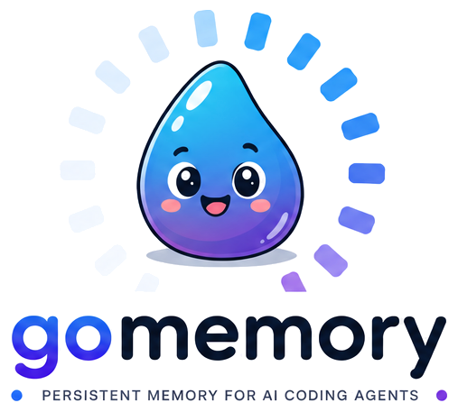
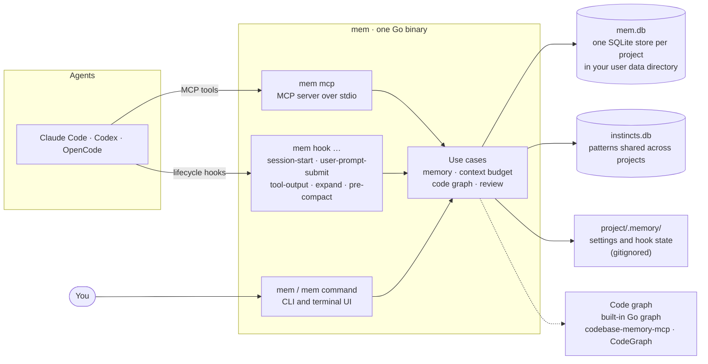

<p align="center">
  <picture>
    <source media="(prefers-color-scheme: dark)" srcset="assets/gomemory-readme-dark.png">
    
  </picture>
</p>

<h3 align="center">Persistent, local and portable memory for AI coding agents</h3>

<p align="center">
  <a href="https://github.com/Sayoner-000/gomemory/releases/latest"></a>
  <a href="https://go.dev/"></a>
  <a href="LICENSE"></a>
  <a href="https://modelcontextprotocol.io/"></a>
</p>

<p align="center">
  <a href="#quick-start">Quick start</a> ·
  <a href="#how-it-works">How it works</a> ·
  <a href="docs/MANUAL.md">Manual</a> ·
  <a href="INSTALLATION.md">Installation</a> ·
  <a href="CHANGELOG.md">Changelog</a>
</p>

---

Your coding agent starts every session from zero. It doesn't remember why you
picked that architecture last week, how the flaky test got fixed, or which
approach you already tried and threw away. So you explain it again, and pay for
those tokens again.

gomemory keeps that context for it. Decisions, bug fixes, learnings and session
checkpoints go into a local SQLite store, one per project, and come back to the
agent through the [Model Context Protocol](https://modelcontextprotocol.io/)
(MCP) when it needs them.

It is a single Go binary. There is no cloud service, no API key and no database
server. Memory lives outside your repository; the project only gets a
`.memory/` folder for settings and hook state, which `mem install` adds to
`.gitignore`.

## Quick start

**1. Install the binary**

```bash
# Linux / macOS
curl -fsSL https://raw.githubusercontent.com/Sayoner-000/gomemory/main/scripts/install.sh | bash
```

On Windows, download `mem_windows_amd64.zip` from
[Releases](https://github.com/Sayoner-000/gomemory/releases/latest), check it
against `checksums.txt` and put `mem.exe` on your PATH. The exact PowerShell
commands are in [`INSTALLATION.md`](INSTALLATION.md).

**2. Connect your agents**

```bash
cd /path/to/your/project
mem install .
```

The guided setup detects the agents you have installed, asks for the
configuration scope and confirms before writing anything. In scripts and CI, use
`mem install . --yes` or `mem install . --agents claude,codex --scope project`.

**3. Try it**

```bash
mem save -t "API routing" -y decision "Use Fiber for HTTP routing"
mem search "API routing"
mem context        # what the agent receives at session start
mem                # interactive terminal UI
```

Memory lives in `~/.local/share/gomemory/` on Linux and macOS, and in
`%LOCALAPPDATA%\gomemory\` on Windows. [`INSTALLATION.md`](INSTALLATION.md)
covers global vs. project scope, `mem setup-mcp`, updates and troubleshooting.

## How it works



gomemory reaches your agent through two channels. Every supported agent
launches `mem mcp` as a stdio subprocess and calls its tools to save and
retrieve memory. Claude Code, Codex and OpenCode also run `mem hook` at points
of their lifecycle: gomemory injects context when a session starts, captures
checkpoints on its own (without spending agent tokens), compresses large tool
output, applies the `expand` rules before a tool runs and keeps session memory
across context compaction.

The same use cases sit behind the MCP server, the hooks and the `mem` CLI, so
what you see in the terminal is what the agent gets.

| Agent | MCP | Lifecycle hooks |
| :--- | :---: | :---: |
| Claude Code | ✅ | ✅ |
| Codex | ✅ | ✅ |
| OpenCode | ✅ | ✅ |

Using an agent that isn't listed? [`docs/AGENT-INTEGRATION.md`](docs/AGENT-INTEGRATION.md)
explains how to connect it.

## What it does

Memory is structured, not a text dump. Each entry has a type (`architecture`,
`decision`, `bugfix`, `pattern`, `learning`, `discovery`, `preference` or
`checkpoint`), and search uses SQLite FTS5 with BM25 ranking.

Context is budgeted. `get_context` stays within a token budget, and the agent
asks `get_memory` for the full entry only when it needs it.
`mem pack` builds context packs with reversible compression, and `mem usage`
reports the tokens it actually saved.

Related memories link to each other and are ranked by centrality (`mem mass`).
Duplicates and memories that point to files that no longer exist are flagged for
review. Nothing is deleted silently.

On top of memory, gomemory ships tools for the work agents do with it:

- `mem plan-context` gives the agent the project's history and an atomic
  task-decomposition method before it plans.
- `mem review` runs an adversarial review with two independent reviewers. A
  defect counts only when both confirm it.
- A built-in Go symbol graph answers code-structure questions. External graph
  providers are optional: [codebase-memory-mcp](https://github.com/DeusData/codebase-memory-mcp)
  and [CodeGraph](https://github.com/colbymchenry/codegraph).
- `mem install` and `mem update` keep a set of skills and guardrails current:
  `defensive-qa-audit`, `socratica` (prompt refinement, and `/socratica-hu`
  to prepare a checked, approved input for Spec Kit's `speckit-specify`) and
  the `expand` protection rules.
- Octopus AAR (opt-in) recommends whether to keep a task inline or hand it to a
  subagent, and says why. It never launches agents itself.

`mem export` and `mem import` move memory between machines as JSON. The
[user manual](docs/MANUAL.md) covers every feature in detail.

### HCD (Harness Continual Development)

HCD is gomemory's own protocol for taking one unit of work (a feature, an
evolution, a fix or a technical improvement) from intent to verified delivery.
It sits next to Spec Kit and never replaces it: existing Spec Kit units stay
Spec Kit until you migrate them on purpose.

- **How you drive it.** Type `/hcd` in Claude Code or OpenCode, or `$hcd` in
  Codex. The agent finds the unit, reads its state from the `mem hcd` engine and
  moves to the next step. You don't type console commands. `mem install` (both
  `project` and `global` scope) and `mem update` add the skills: `hcd`, `hcd-define`, `hcd-clarify`, `hcd-approve`,
  `hcd-slice`, `hcd-tasks`, `hcd-implement`, `hcd-verify`, `hcd-close`,
  `hcd-exception`, `hcd-playbook` and `hcd-migrate`.
- **What the engine keeps.** Control state lives in SQLite (`hcd_*` tables);
  `definition.md`, `delivery.md` and the generated `verification.md` live under
  `hcd/features/`. Decisions are mirrored into memory as `type=decision`.
  A Playbook (rules, exceptions with an owner and an expiry) is pinned per unit;
  a new revision changes nothing until you adopt it.
- **MCP-only environments.** An agent that only has the MCP server sees the
  "HCD activo" section of `get_context` and gets assistance. Managed execution
  (grants, reports, verification) needs the skills and the engine.
- **Active unit and heartbeat.** One unit is active per project. The end-of-turn
  hook records a heartbeat and flags structural drift (files touched without a
  granted run, a granted run with no report, a unit idle for `hcd_inactive_days`).
  Drift appears as a warning; it never blocks the turn.
- **What it doesn't guarantee.** It checks structure and evidence, not that the
  code is correct. Whether an agent follows the skills is up to the agent. The
  engine can't tell when a change widens the scope; the skills make that the
  agent's duty.
- **The risk of the quote.** Approvals need your literal reply, recorded with its
  origin (`conversation` or `terminal`), client, date and revision. That is
  auditable, but it relies on trusting the agent to pass your words faithfully.
  The TUI starts and shows units; it does not approve.

Support per agent is declared only where there is a recorded end-to-end run
under `specs/045-hcd-protocol/evidence/`:

| Agent | Invocation | Status |
|---|---|---|
| Claude Code | `/hcd` | Supported: full run from `start` to `completed` (`mvp-claude.md`) |
| Codex | `$hcd` | Supported: full run (`env-codex.md`). Its `workspace-write` sandbox must be allowed to write `~/.local/share/gomemory`: add it to `[sandbox_workspace_write] writable_roots` in `~/.codex/config.toml`, or start with `codex --add-dir ~/.local/share/gomemory` |
| OpenCode | `/hcd` | Supported: full run (`env-opencode.md`). In non-interactive `opencode run`, a message that starts with `/hcd` hung; asking it to load the `hcd` skill works |

`mem hcd --help` lists every engine command. The Spanish
[SDD_HCD guide](docs/Guia-SDD_HCD_GOMEMORY-v2.40.html) walks through the
ceremony step by step (chapters 16 and 17). See
[`docs/ARQUITECTURA.md`](docs/ARQUITECTURA.md) for the design.

## Reference

<details>
<summary><b>CLI</b></summary>

| Command | Purpose |
| :--- | :--- |
| `mem install .` | Guided setup for a project |
| `mem save` / `mem search` / `mem list` | Write and query memory |
| `mem context` / `mem plan-context` | Show what the agent receives |
| `mem settings` | View or change project settings |
| `mem doctor` | Check agent integration and installed binaries |
| `mem update` | Update the binary (SHA-256 verified) |
| `mem export` / `mem import` | Back up or move memory |
| `mem uninstall` | Remove gomemory from a project, or everywhere with `--all` |

Run `mem help` for the full command list and examples. Every setting is
documented in [`docs/CONFIGURATION.md`](docs/CONFIGURATION.md).

</details>

<details>
<summary><b>MCP tools</b> (31, plus 4 with Octopus AAR)</summary>

The source of truth is [`domain/mcp_tools.go`](domain/mcp_tools.go).

| Group | Tools |
| :--- | :--- |
| Memory | `save_memory` `search_memories` `list_memories` `get_memory` `get_context` `get_plan_context` `start_session` `end_session` `save_session_summary` `forget_memory` `judge_memories` |
| Code graph | `index_project` `graph_status` `search_code` `get_symbol` `list_dependencies` |
| Context packs | `pack_build` `pack_show` `pack_stats` `pack_compress` `pack_retrieve` `pack_savings` |
| Consensus review | `review_start` `review_submit` `review_consensus` `review_status` `review_fix_record` `review_rejudge` `review_finalize` `review_promote_memory` |
| Socratica | `socratica_flow` |
| Octopus AAR (optional) | `octopus_route_task` `octopus_route_plan` `octopus_report` `octopus_status` |

Resources: `mem://context` · `mem://memory/{id}`

</details>

## Security and privacy

Your data stays on your machine, in files only your user can read, outside the
repository. gomemory opens no network port. It goes online only to check for a
new release, which you can turn off, and to download one when you run
`mem update`.

Common credential patterns are redacted before they are stored, and anything
wrapped in `<private>…</private>` is never persisted.

Don't sync `mem.db` directly. It runs in SQLite WAL mode, and a copy taken while
it is open can be inconsistent. Use `mem export` instead. The
[manual](docs/MANUAL.md) lists the details and limitations.

## Documentation

| Document | Contents |
| :--- | :--- |
| [`INSTALLATION.md`](INSTALLATION.md) | Installation, agent registration, updates, troubleshooting |
| [`docs/MANUAL.md`](docs/MANUAL.md) | Complete user guide |
| [`docs/CONFIGURATION.md`](docs/CONFIGURATION.md) | Settings reference |
| [`docs/architecture.md`](docs/architecture.md) | Internal architecture |
| [`docs/MEMORY-PROTOCOL.md`](docs/MEMORY-PROTOCOL.md) | Memory protocol reference |
| [`docs/AGENT-INTEGRATION.md`](docs/AGENT-INTEGRATION.md) | Integrating an agent gomemory doesn't support yet |
| [`docs/socratica.md`](docs/socratica.md) · [`docs/expand.md`](docs/expand.md) | Socratica and expand supertools |
| [`docs/USAGE-REPORT-CONTRACT.md`](docs/USAGE-REPORT-CONTRACT.md) · [`docs/CONSOLE-THEMES.md`](docs/CONSOLE-THEMES.md) | Usage report contract, TUI themes |
| [`docs/Guia-Tecnica_GOMEMORY-v2.40.html`](docs/Guia-Tecnica_GOMEMORY-v2.40.html) · [`docs/Guia-SDD_HCD_GOMEMORY-v2.40.html`](docs/Guia-SDD_HCD_GOMEMORY-v2.40.html) | Printable technical and SDD_HCD guides (Spanish; previous editions in `docs/editions/`) |

## Contributing

Bug reports and ideas go in [issues](https://github.com/Sayoner-000/gomemory/issues).
Before sending a change, read [`CONTRIBUTING.md`](CONTRIBUTING.md) and the
[`CODE_OF_CONDUCT.md`](CODE_OF_CONDUCT.md).

To build from source you need Go 1.27+:

```bash
git clone https://github.com/Sayoner-000/gomemory.git
cd gomemory
go build -o mem ./infrastructure/
./mem install .
```

## License

MIT, see [`LICENSE`](LICENSE). Created by Sayoner ([@Sayoner-000](https://github.com/Sayoner-000)).
