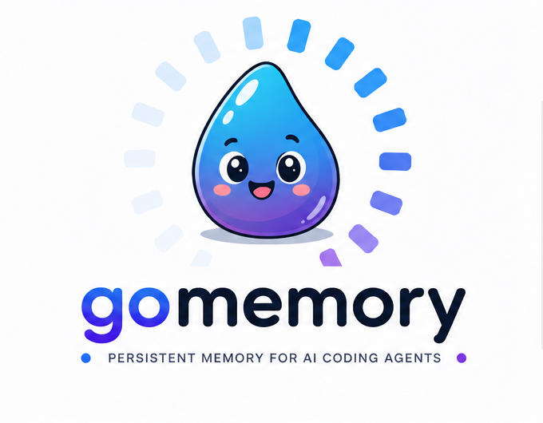

<p align="center">
  
</p>

<p align="center">
  <strong>Persistent, local and portable memory for AI coding agents</strong>
</p>

[](https://github.com/Sayoner-000/gomemory/releases/latest)
[](https://go.dev/)
[](LICENSE)
[](https://modelcontextprotocol.io/)

AI coding agents forget everything when a session ends: why an architecture was
chosen, how a bug was fixed, which approach was rejected. gomemory keeps that
context — decisions, bug fixes, learnings and session checkpoints — in a local
SQLite store, and serves it back to the agent through the
[Model Context Protocol](https://modelcontextprotocol.io/) (MCP).

```
 Claude Code · OpenCode · Codex       MCP + lifecycle hooks
 Cursor · Windsurf · Cline            MCP
                 │  stdio
                 ▼
              gomemory  ──►  one SQLite store per project,
                             outside your repository
```

No cloud service, no API key, no database server, and no memory files in your repository.

## Quick start

**1. Install**

```bash
# Linux / macOS
curl -fsSL https://raw.githubusercontent.com/Sayoner-000/gomemory/main/scripts/install.sh | bash
```

```powershell
# Windows (PowerShell)
irm https://raw.githubusercontent.com/Sayoner-000/gomemory/main/scripts/install.ps1 | iex
```

**2. Connect your agents**

```bash
cd /path/to/your/project
mem install .
```

The guided setup detects your installed agents, asks for the configuration scope
and confirms before writing anything. For scripts and CI, use `mem install . --yes`
or `mem install . --agents claude,codex --scope project`. See
[`INSTALLATION.md`](INSTALLATION.md) for global vs. project scope, `mem setup-mcp`,
updates and troubleshooting.

**3. Try it**

```bash
mem save -t "API routing" -y decision "Use Fiber for HTTP routing"
mem search "API routing"
mem context        # what the agent receives at session start
mem                # interactive terminal UI
```

Memory lives in `~/.local/share/gomemory/` (Linux/macOS) or `%LOCALAPPDATA%\gomemory\` (Windows).

## Supported agents

| Agent | MCP | Automatic lifecycle hooks |
| :--- | :---: | :---: |
| Claude Code | ✅ | ✅ |
| OpenCode | ✅ | ✅ |
| Codex | ✅ | ✅ |
| Cursor | ✅ | — |
| Windsurf | ✅ | — |
| Cline | ✅ | — |

With lifecycle hooks, gomemory injects context at session start, captures
checkpoints automatically (without spending agent tokens) and preserves session
memory across context compaction.

## Features

- **Structured memory** — typed entries (`architecture`, `decision`, `bugfix`,
  `pattern`, `learning`, `discovery`, `preference`, `checkpoint`) instead of a text dump.
- **Relevant, budgeted retrieval** — FTS5 + BM25 search; `get_context` stays within
  a token budget and `get_memory` returns full details on demand.
- **Connected memory** — related memories are linked automatically and ranked by
  centrality (`mem mass`); duplicates and stale file anchors are flagged, never deleted silently.
- **Privacy by design** — common credential patterns are redacted, and anything
  wrapped in `<private>…</private>` is never persisted.
- **Planning support** — `mem plan-context` gives agents project history and an
  atomic task-decomposition method before they plan.
- **Context optimization** — `mem pack` builds token-budgeted context packs with
  reversible compression; `mem usage` reports measured token savings.
- **Adversarial consensus review** — `mem review` runs two independent reviewers;
  a defect counts only when both confirm it.
- **Code graph** — a built-in Go symbol graph, plus optional external providers
  (`codebase-memory-mcp`, [CodeGraph](https://github.com/colbymchenry/codegraph)).
- **Skills and guardrails** — `defensive-qa-audit`, `socratica` prompt refinement,
  and `expand` protection rules, installed and updated by `mem install`/`mem update`.
- **Octopus AAR (opt-in)** — recommends whether to keep work inline or delegate it
  to a subagent, with an explained reason. It never runs agents itself.
- **Portable** — `mem export` / `mem import` move memory between machines as JSON.

The [user manual](docs/MANUAL.md) covers each feature in detail.

## MCP tools

31 core tools, plus 4 when Octopus AAR is enabled. The source of truth is
[`domain/mcp_tools.go`](domain/mcp_tools.go).

| Group | Tools |
| :--- | :--- |
| Memory | `save_memory` `search_memories` `list_memories` `get_memory` `get_context` `get_plan_context` `start_session` `end_session` `save_session_summary` `forget_memory` `judge_memories` |
| Code graph | `index_project` `graph_status` `search_code` `get_symbol` `list_dependencies` |
| Context packs | `pack_build` `pack_show` `pack_stats` `pack_compress` `pack_retrieve` `pack_savings` |
| Consensus review | `review_start` `review_submit` `review_consensus` `review_status` `review_fix_record` `review_rejudge` `review_finalize` `review_promote_memory` |
| Socratica | `socratica_flow` |
| Octopus AAR (optional) | `octopus_route_task` `octopus_route_plan` `octopus_report` `octopus_status` |

Resources: `mem://context` · `mem://memory/{id}`

## CLI

| Command | Purpose |
| :--- | :--- |
| `mem install .` | Guided setup for a project |
| `mem save` / `mem search` / `mem list` | Write and query memory |
| `mem context` / `mem plan-context` | Show what the agent receives |
| `mem settings` | View or change project settings |
| `mem doctor` | Check agent integration and installed binaries |
| `mem update` | Update the binary (SHA-256 verified) |
| `mem export` / `mem import` | Back up or move memory |
| `mem uninstall` | Remove gomemory from a project, or everywhere with `--all` |

Run `mem help` for the full command list and examples. All settings are
documented in [`docs/CONFIGURATION.md`](docs/CONFIGURATION.md).

## Security & privacy

Data stays on your machine, in owner-only files outside the repository. gomemory
opens no network port: agents launch `mem mcp` as a stdio subprocess, and the
background update check can be disabled. Do not sync `mem.db`
directly (SQLite WAL mode); use `mem export` instead. See
[`docs/MANUAL.md`](docs/MANUAL.md) for details and limitations.

## Documentation

| Document | Contents |
| :--- | :--- |
| [`INSTALLATION.md`](INSTALLATION.md) | Installation, agent registration, updates, troubleshooting |
| [`docs/MANUAL.md`](docs/MANUAL.md) | Complete user guide |
| [`docs/CONFIGURATION.md`](docs/CONFIGURATION.md) | Settings reference |
| [`docs/architecture.md`](docs/architecture.md) | Internal architecture |
| [`docs/MEMORY-PROTOCOL.md`](docs/MEMORY-PROTOCOL.md) | Memory protocol reference |
| [`docs/AGENT-INTEGRATION.md`](docs/AGENT-INTEGRATION.md) | Integrating an agent gomemory doesn't support yet |
| [`docs/socratica.md`](docs/socratica.md) · [`docs/expand.md`](docs/expand.md) | Socratica and expand supertools |
| [`docs/USAGE-REPORT-CONTRACT.md`](docs/USAGE-REPORT-CONTRACT.md) · [`docs/CONSOLE-THEMES.md`](docs/CONSOLE-THEMES.md) | Usage report contract, TUI themes |
| [`docs/Guia-Tecnica_GOMEMORY-v2.36.html`](docs/Guia-Tecnica_GOMEMORY-v2.36.html) · [`docs/Guia-SDD_GOMEMERY-v2.36.html`](docs/Guia-SDD_GOMEMERY-v2.36.html) | Printable technical and SDD guides (previous editions in `docs/editions/`) |

## Building from source

Requires Go 1.27+.

```bash
git clone https://github.com/Sayoner-000/gomemory.git
cd gomemory
go build -o mem ./infrastructure/
./mem install .
```

Contributions are welcome. Read [`CONTRIBUTING.md`](CONTRIBUTING.md) and the
[`CODE_OF_CONDUCT.md`](CODE_OF_CONDUCT.md), and
[open an issue](https://github.com/Sayoner-000/gomemory/issues) for bugs or ideas.

## License

MIT, see [`LICENSE`](LICENSE). Created by Sayoner ([@Sayoner-000](https://github.com/Sayoner-000)).
